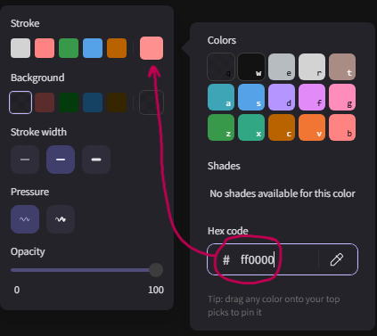
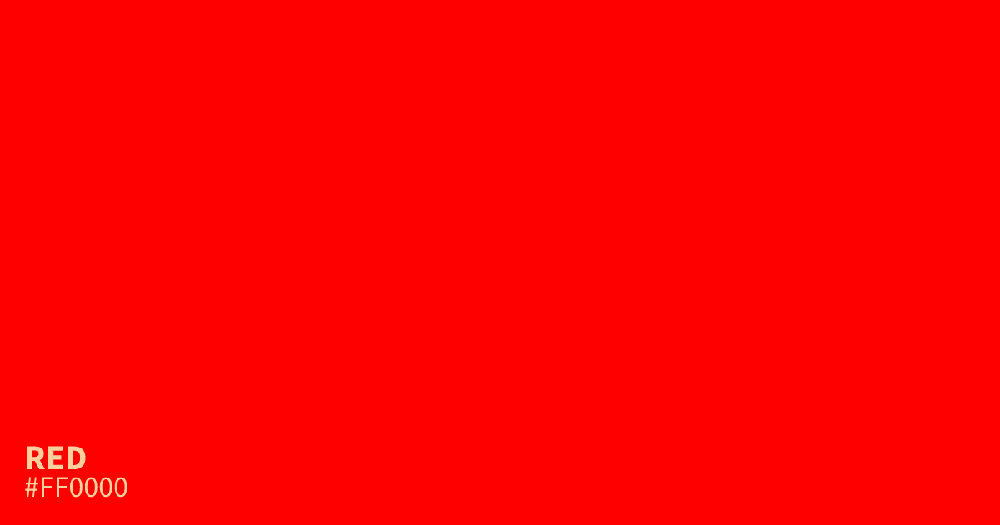
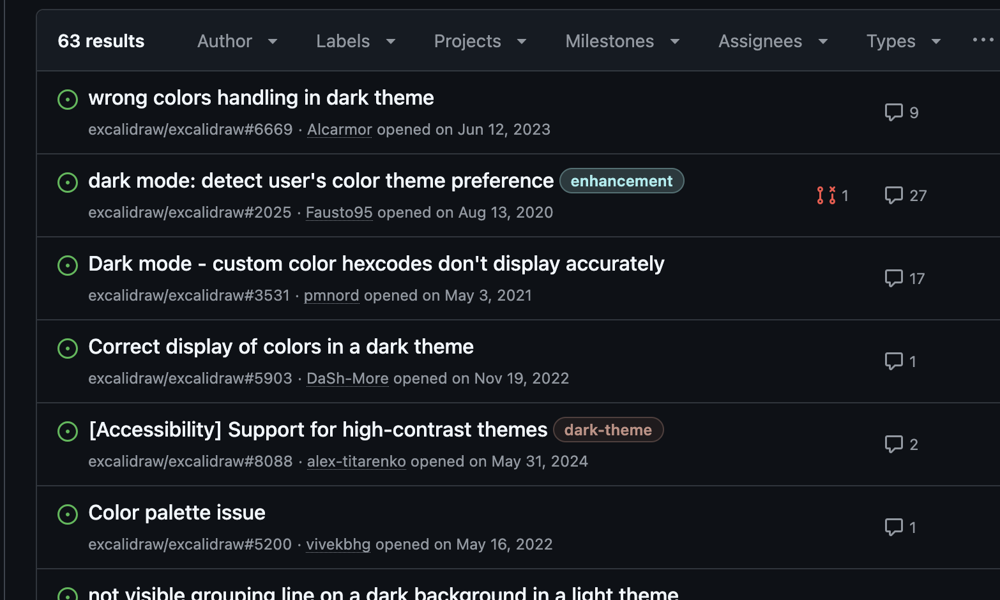
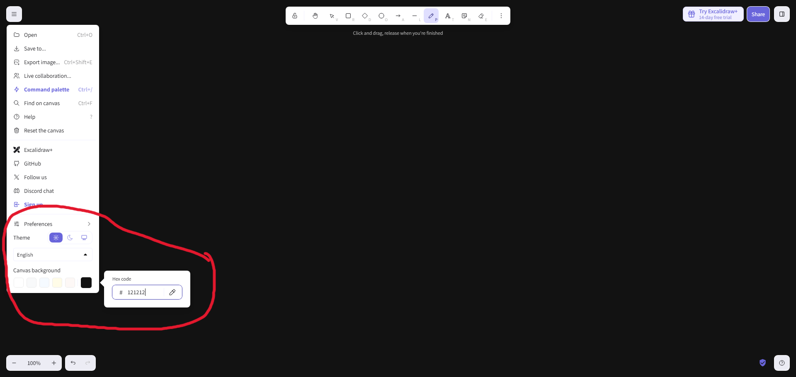
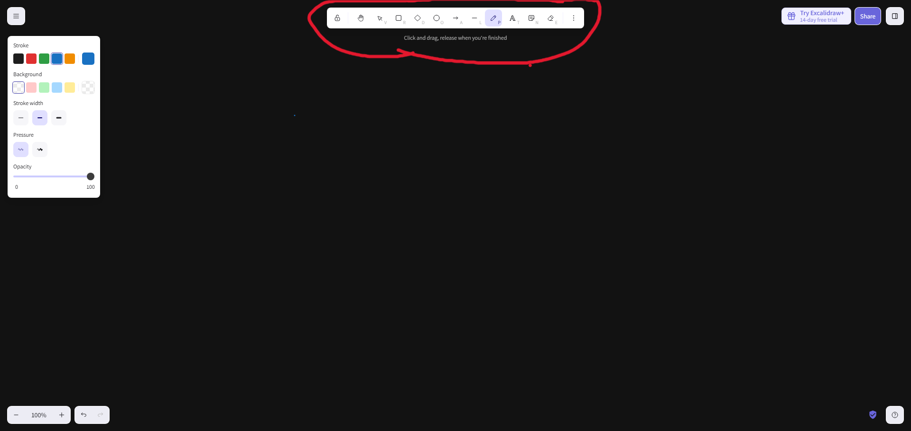
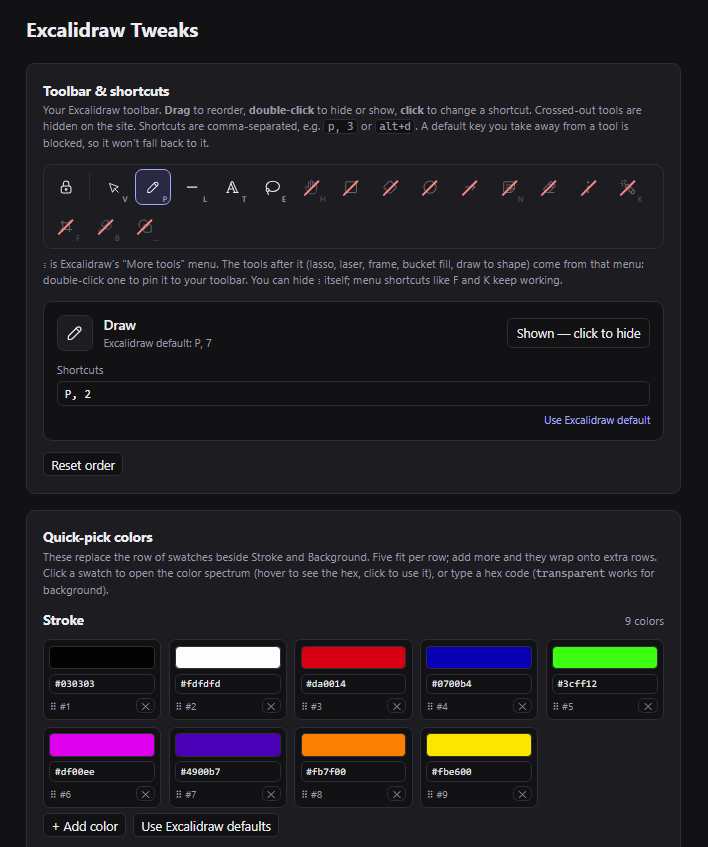
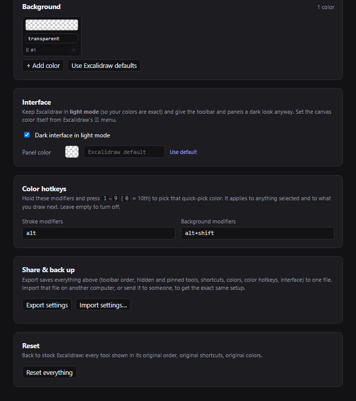
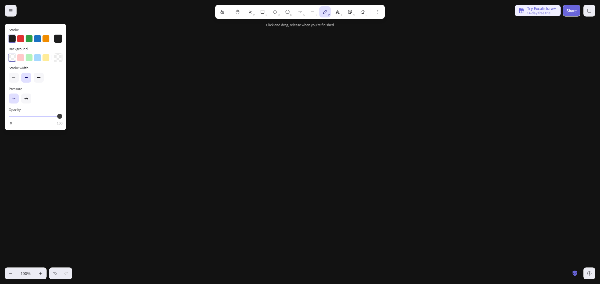
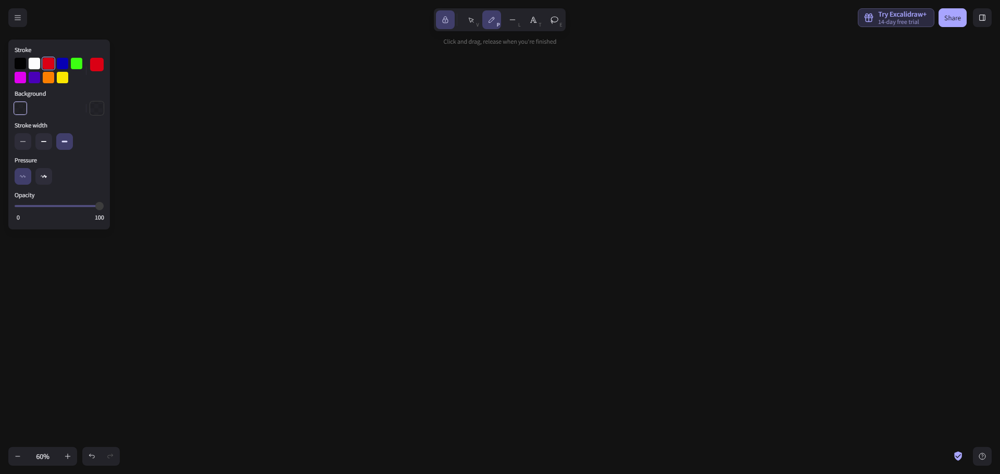

# Excalidraw Tweaks

A small Chrome extension for excalidraw.com that gives you true colors, 
your own color palette, and a toolbar with only the tools you want to use

### Problems

I always use Excalidraw in dark mode, but the issue is that dark mode doesn't give you the colors you actually want to pick. For example, here's `#ff0000` selected as my pencil color:



This is what `#ff0000` actually looks like:



This is because Excalidraw’s dark mode doesn’t use actual dark colors. 
It runs every color through an invert-and-hue-rotate filter, which then washes saturated colors out. 
Pure red `#ff0000` renders as salmon pink `#ff9090` and no input color produces a true bright red

Lots of people seem to dislike this! (credits for screenshot: [@skeary](https://github.com/skearya))





### Current Workaround

The workaround is to use Light mode and set the canvas background to black:



That fixes the colors, but creates two new problems:
- The first default color is black, which is useless on a black background. The issue is that Excalidraw doesn't let you change its pinned colors, so if the only colors you want are white, 
red, blue, and green, you're stuck re-picking them by hand over and over
- The Excalidraw UI is now blindingly bright compared to the black canvas

And an unrelated, but also frustrating third problem, the toolbar!



I've used Excalidraw for years and never touched half of those tools. They're just in the way


### So what the extension does do
- Your own pinned colors for stroke and background, as many as you want (they wrap onto extra rows)
- Dark interface in light mode: dark toolbar and panels while the canvas keeps true colors
- Toolbar control: hide tools you don't need and pin tools you do
- Custom shortcuts: remap any tool, including several keybinds for a tool




### Before Extension



### After Extension



Key changes are 

1. The UI being dark WITH the dark theme
2. 10 pinned colors for easy access
3. Cleaned up toolbar

Much better!

### Setup

```bash
git clone https://github.com/imad-shah/excalidraw-tweaks.git
```

Head over to `chrome://extensions`, enable **Developer mode** (top right), click **Load unpacked**, and select the cloned `excalidraw-tweaks` folder.

Then:
1. Open (or refresh) [excalidraw.com](https://excalidraw.com) so the extension can read the toolbar 
2. Click the extension's icon to open the settings page and set things up 

**For getting true colors on dark mode**: keep Excalidraw in **light mode**, set the canvas color from `Canvas background` 
to something dark like `#121212`, and enable **Dark interface in light mode** in the 
extension settings

### Updating

```bash
git pull
```

Then hit the reload arrow on Excalidraw Tweaks in `chrome://extensions` and refresh Excalidraw. Your settings stay, as long as you don't remove the extension. Export them from the settings page anyway, just in case.


### Warning: this is fragile

This is not built on an official API. It hooks into excalidraw.com's internal UI and app state, so an Excalidraw update can break parts of it at any time.

[`MAINTAINING.md`](MAINTAINING.md) records exactly how everything worked as of v0.6.2: every Excalidraw internal it depends on, every bug hit along the way, and console snippets to find what changed. If something breaks, give that file to an agent along with what broke, and it can pick up where this 
left off.
